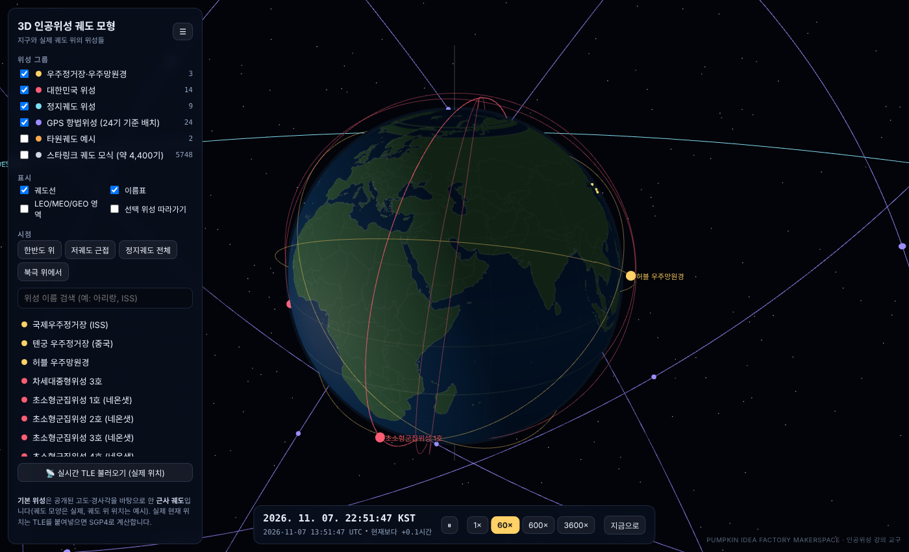
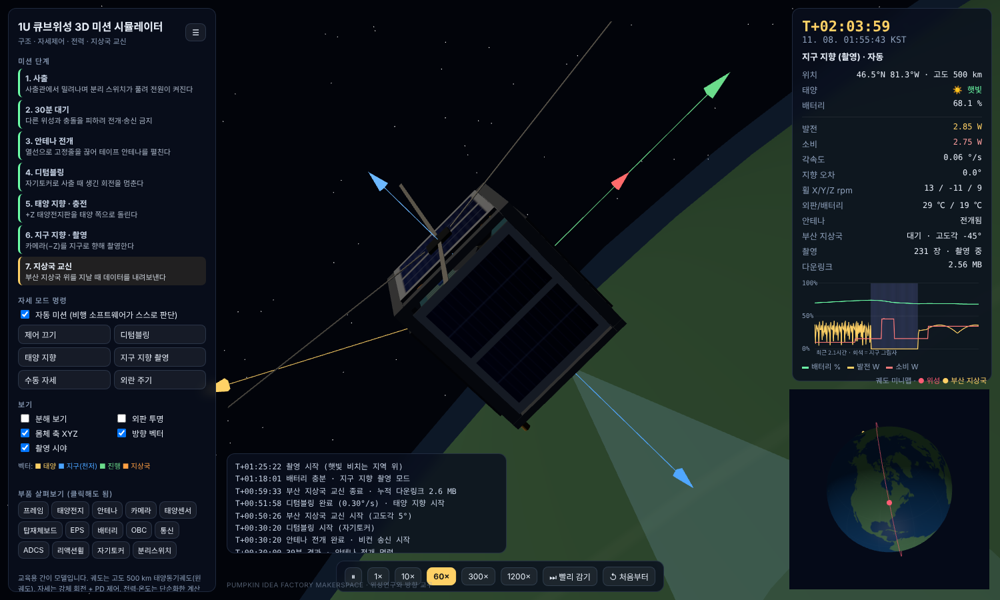
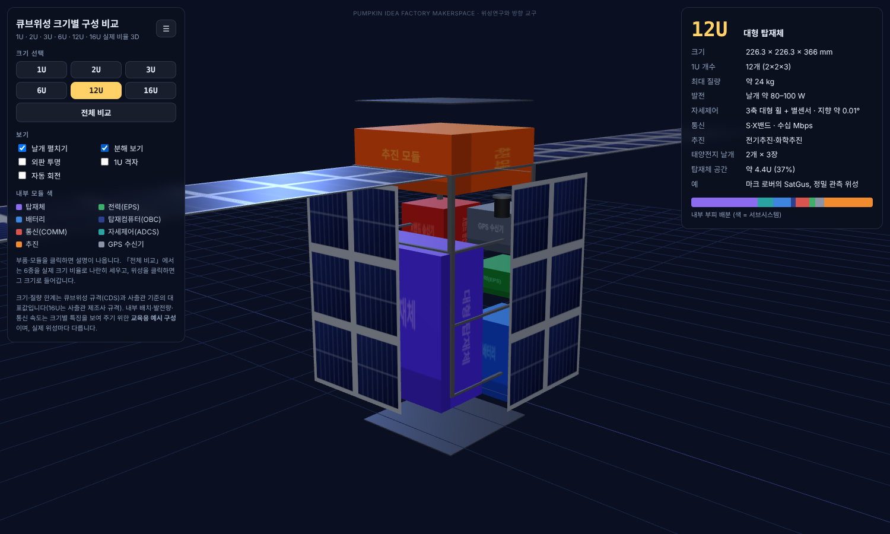
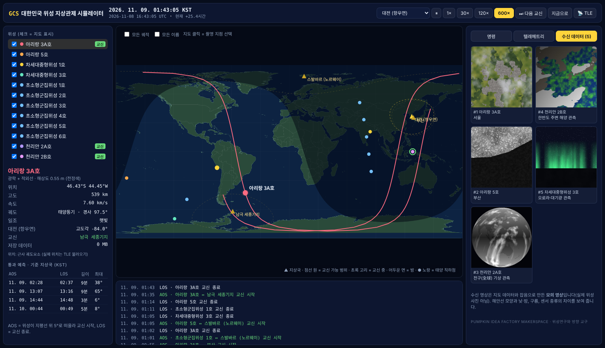
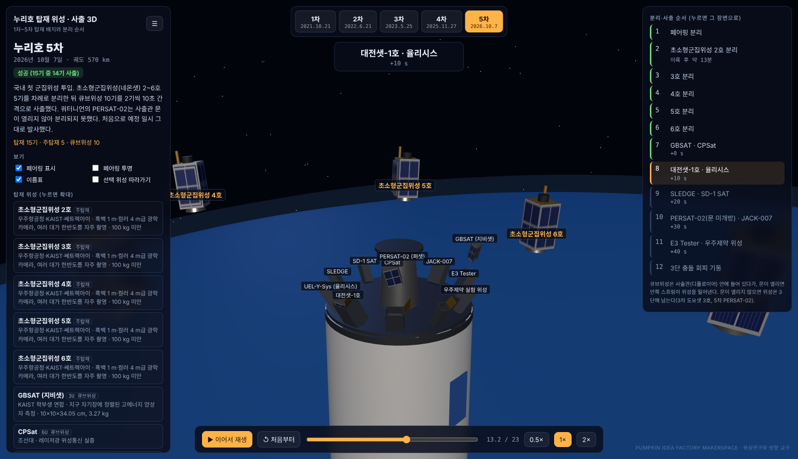

# 🛰️ 위성연구와 방향 — 교육용 위성 3D 시뮬레이터 모음

**Satellite Education Simulators** · 고등학생 대상 인공위성 강의 「위성연구와 방향」에서 쓰는 브라우저 3D 시뮬레이터 5종

> PUMPKIN IDEA FACTORY MAKERSPACE (호박공장메이커스페이스) · 공장장 장홍직

설치 없이 `index.html`을 브라우저로 열면 바로 실행됩니다. 필요한 라이브러리가 모두 파일 안에 들어 있어 **인터넷이 없는 교실에서도 동작**합니다.

---

## 📦 시뮬레이터 목록

| # | 시뮬레이터 | 폴더 | 무엇을 배우나 |
|---|---|---|---|
| 1 | **지구 궤도 위성 3D** | [`orbit-3d/`](orbit-3d/) | LEO·SSO·MEO·GEO 궤도, 주요 위성 위치, TLE 입력으로 실제 위치 계산 |
| 2 | **1U 큐브위성 임무 시뮬레이터** | [`cubesat-mission/`](cubesat-mission/) | 사출 → 디텀블링 → 자세제어(리액션휠) → 촬영 → 지상국 교신까지의 임무 흐름 |
| 3 | **큐브위성 크기 비교 3D** | [`cubesat-sizes/`](cubesat-sizes/) | 1U·2U·3U·6U·12U·16U 크기, 질량, 내부 구성과 임무 차이 |
| 4 | **대한민국 위성 GCS 시뮬레이터** | [`korea-gcs/`](korea-gcs/) | 지상관제(GCS) 화면, 통과 예측(AOS/LOS), 촬영 명령, 센서·텔레메트리 확인 |
| 5 | **누리호 1~5차 탑재·사출 3D** | [`nuri-payload/`](nuri-payload/) | 차수별 탑재 위성 배치, 페어링 분리, 위성·큐브위성 사출 순서 |

### 미리보기

| 지구 궤도 위성 3D | 1U 큐브위성 임무 |
|---|---|
|  |  |

| 큐브위성 크기 비교 | 대한민국 위성 GCS |
|---|---|
|  |  |

| 누리호 탑재·사출 |
|---|
|  |

---

## 🚀 바로 실행하기

### 방법 1 — 파일로 열기 (가장 간단)
1. 이 저장소를 내려받습니다 (`Code` → `Download ZIP`).
2. 원하는 폴더의 `index.html`을 Chrome·Edge·Safari로 엽니다.

> 글꼴은 웹폰트를 불러오지 못하면 기본 글꼴로 표시됩니다. 기능에는 영향이 없습니다.

### 방법 2 — GitHub Pages로 링크 공유 (수업용 추천)
1. 저장소 `Settings` → `Pages` → Branch를 `main` / `(root)`로 지정하고 저장합니다.
2. 1~2분 뒤 아래 주소로 접속할 수 있습니다. 학생들에게 QR코드로 나눠주기 좋습니다.

```
https://makerpif.github.io/satellite-edu-simulators/orbit-3d/
https://makerpif.github.io/satellite-edu-simulators/cubesat-mission/
https://makerpif.github.io/satellite-edu-simulators/cubesat-sizes/
https://makerpif.github.io/satellite-edu-simulators/korea-gcs/
https://makerpif.github.io/satellite-edu-simulators/nuri-payload/
```

> 저장소 이름을 바꾸면 주소의 `satellite-edu-simulators` 부분도 바뀝니다.

**권장 환경:** 데스크톱/노트북 Chrome 또는 Edge 최신 버전 (WebGL 필요). 태블릿에서도 동작하지만 화면이 좁으면 패널이 겹칠 수 있습니다.

---

## 🧭 사용법과 수업 팁

### 1. 지구 궤도 위성 3D (`orbit-3d`)
- 마우스 드래그로 회전, 휠로 확대·축소. 위성을 클릭하면 궤도 정보가 표시됩니다.
- 시간 배속을 올려 **저궤도(약 90분)와 정지궤도(24시간)의 주기 차이**를 직접 비교해 보세요.
- **TLE 붙여넣기:** [CelesTrak](https://celestrak.org/)에서 최신 TLE를 복사해 넣으면 SGP4로 계산한 실제 위치가 표시됩니다.
- 💡 수업 팁: "왜 정지궤도 위성은 적도 위에만 있을까?"를 질문한 뒤 궤도 경사각을 보여주세요.

### 2. 1U 큐브위성 임무 시뮬레이터 (`cubesat-mission`)
- 단계별로 사출 → 자기토커 디텀블링 → 리액션휠 자세제어 → 촬영 → 교신이 진행됩니다.
- 리액션휠 포화, 배터리·온도 변화, 일식 구간을 그래프로 확인할 수 있습니다.
- 💡 수업 팁: 3D프린팅 1U 교육용 큐브위성 실습 전에 "임무 시나리오 짜기" 활동으로 활용하세요.

### 3. 큐브위성 크기 비교 3D (`cubesat-sizes`)
- 1U(10×10×10 cm, 최대 약 2 kg)부터 16U까지 나란히 비교하고, 내부 모듈(전원·통신·OBC·탑재체)을 펼쳐 볼 수 있습니다.
- 스마트폰과 크기를 비교해 실제 크기를 감각적으로 이해할 수 있습니다.

### 4. 대한민국 위성 GCS 시뮬레이터 (`korea-gcs`)
- 아리랑·차세대중형위성·천리안 등 대한민국 위성을 선택해 지상국 통과 시각(AOS/LOS)을 예측합니다.
- 촬영 명령을 보내고 광학/SAR 영상과 센서·텔레메트리 데이터를 확인합니다.
- 💡 수업 팁: 학생을 "관제팀"과 "임무계획팀"으로 나눠 다음 통과 시각에 맞춰 촬영 계획을 세우게 해 보세요.

### 5. 누리호 1~5차 탑재·사출 3D (`nuri-payload`)
- 차수를 고르고 재생하면 페어링 분리 → 주탑재위성 분리 → 큐브위성 사출이 순서대로 재생됩니다.
- 타임라인을 드래그해 원하는 장면으로 이동할 수 있고, 내부 배치를 투명하게 볼 수 있습니다.

---

## ⚠️ 데이터 출처와 한계 (꼭 읽어주세요)

이 시뮬레이터들은 **교육용 모형**입니다. 실제 운용 데이터와 다를 수 있습니다.

- **위성 위치:** 기본 위치는 근사 궤도요소로 계산한 값입니다. 정확한 현재 위치가 필요하면 CelesTrak의 최신 TLE를 붙여넣으세요.
- **GCS의 영상과 텔레메트리:** 모두 **시뮬레이션으로 만든 가상 데이터**입니다. 실제 위성 영상이 아닙니다. 실제 영상은 [K-Sat 위성정보활용센터](https://www.ksat.kr/), [NASA Worldview](https://worldview.earthdata.nasa.gov/), [Copernicus Browser](https://browser.dataspace.copernicus.eu/) 등에서 확인할 수 있습니다.
- **누리호 탑재 배치:** 공개 자료를 바탕으로 **단순화한 배치**입니다. 3차 큐브위성의 사출 순서와 5차 일부 큐브위성 명칭은 확인되지 않은 부분이 있습니다.
- **큐브위성 규격:** CubeSat Design Specification(CDS) 기준 대표값입니다. 16U 질량은 근사값입니다.
- **궤도 모델:** 케플러 궤도에 J2 섭동(승교점 이동)만 반영했습니다. 대기 저항 등은 단순화했습니다.

오류나 더 정확한 자료를 알고 계시면 [Issues](../../issues)로 알려주세요.

---

## 🛠️ 직접 수정하고 다시 빌드하기

각 시뮬레이터는 `src/app.js`(코드)와 `src/template.html`(화면)로 이루어져 있고, 빌드하면 라이브러리까지 모두 들어간 `index.html` 한 파일이 만들어집니다.

```bash
# 1) 의존성 설치 (Node.js 18 이상)
npm install

# 2) 5개 시뮬레이터 모두 빌드 → 각 폴더의 index.html 갱신
npm run build
```

빌드 스크립트(`build.mjs`)는 esbuild로 `src/app.js`를 하나의 스크립트로 묶은 뒤 `src/template.html`의 `/*__BUNDLE__*/` 자리에 넣습니다.

### 기술 스택
| 라이브러리 | 용도 |
|---|---|
| [three.js](https://threejs.org/) 0.160 | 3D 렌더링 |
| [satellite.js](https://github.com/shashwatak/satellite-js) 5 | TLE 해석, SGP4 궤도 전파 |
| [topojson-client](https://github.com/topojson/topojson-client) + [world-atlas](https://github.com/topojson/world-atlas) | 지구 대륙 텍스처 |
| [esbuild](https://esbuild.github.io/) | 번들링 |

---

## 📁 폴더 구조

```
satellite-edu-simulators/
├── README.md
├── package.json
├── build.mjs              # 전체 빌드 스크립트
├── orbit-3d/
│   ├── index.html         # 실행 파일 (빌드 결과)
│   └── src/
│       ├── app.js
│       └── template.html
├── cubesat-mission/       # (같은 구조)
├── cubesat-sizes/
├── korea-gcs/
├── nuri-payload/
└── docs/images/           # README 미리보기 이미지
```

---

## 📜 라이선스

- **이 프로젝트:** _라이선스를 선택해 주세요._ 교육 자료로 자유롭게 쓰이길 원하면 [MIT License](https://choosealicense.com/licenses/mit/)를 추천합니다. (`Add file` → `Create new file` → 파일명 `LICENSE` 입력 → `Choose a license template`)
- **포함된 서드파티 라이브러리:**
  - three.js — MIT License
  - satellite.js — MIT License
  - topojson-client — ISC License
  - world-atlas — ISC License (지도 데이터: [Natural Earth](https://www.naturalearthdata.com/), Public Domain)

---

## 🙌 만든 곳

**PUMPKIN IDEA FACTORY MAKERSPACE** (호박공장메이커스페이스) · 부산
공장장 **장홍직**

- GitHub: [github.com/makerPIF](https://github.com/makerPIF)
- YouTube: [youtube.com/@PumpkinIdeaFactory](https://www.youtube.com/@PumpkinIdeaFactory)
- Facebook: [facebook.com/pumpkinideafactory](https://www.facebook.com/pumpkinideafactory)

학생 우주 교육, 큐브위성·탐사로버 프로젝트에 관심 있는 학교와 선생님의 연락을 환영합니다. 🚀
